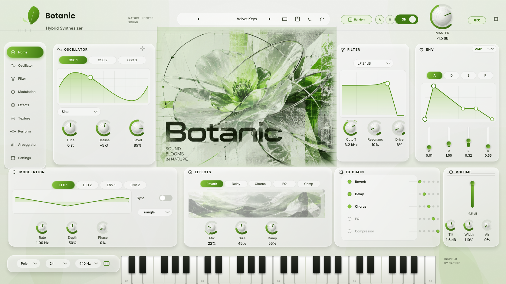

# Botanic

**混合波形表合成器 · 温暖的声音，长在自然里**
**Hybrid wavetable synthesizer — warm sounds that grow wild.**

[](LICENSE)
[](https://github.com/juce-framework/JUCE)
[](#build-from-source)



---

## 中文

### 简介

**Botanic** 是一款混合波形表合成器：三个振荡器、梯形与 SVF 双滤波、10×19 调制矩阵、
可自由排序的效果链，以及一个「纹理实验室」——颗粒云、故障卡带、可以在 A‑E‑I‑O‑U 之间
变形的元音共振峰。自然的声音与数字的崩坏可以互相生长。

界面中英双语一键切换；中间的主视觉会跟着音色变色、跟着声音震荡，每弹一个音就泛起一圈涟漪。

### 特性

| | |
| --- | --- |
| **振荡器** | 3 × 波形表，每个 1–8 层 Unison，独立失谐 / 相位 / 声像 / 键位；8 张表 × 16 帧连续变形 |
| **抗混叠** | 每张表 9 级 mipmap；整条发声链在 **2 倍采样率**下运行，63 抽头半带滤波降回宿主率 |
| **滤波器** | TPT 梯形 LP24（带驱动饱和）+ SVF（LP12 / BP / HP / Notch），双滤波架构 |
| **调制** | 双 ADSR + 双 LFO（9 种波形，含混沌/脉冲）+ **10 源 × 19 目标**矩阵 |
| **纹理** | GRAIN 48 粒子 / 2 秒缓冲 / 冻结；GLITCH 位深、降采样、跟拍 stutter/tape/gate/dropout；VOWEL 三共振峰元音变形 |
| **效果** | 混响 / 延迟 / 合唱 / EQ / 压缩，5 槽**自由排序** |
| **总线** | Tilt / Width / Air、峰值限制器、DC 阻断、静音自动收尾 |
| **演奏** | 琶音器、可分配 XY 宏 + 运动、A/B 对比、40 步撤销、MIDI Learn、屏幕钢琴 + 电脑键盘 |
| **预设** | 38 个工厂音色（常规 + 故障/粒子/元音实验） |
| **界面** | 1672×941 矢量式界面、60 fps 动画、中文 / English |

### 系统需求

- **Windows** 10/11 x64：VST3 + 独立版
- **macOS** 10.13+：VST3 / AU / 独立版（在 Mac 上编译，见 [BUILD-MAC.md](BUILD-MAC.md)）

### 从源码编译

需要 CMake ≥ 3.22 与 C++17 编译器。JUCE 会在首次配置时自动下载（若已有
`third_party/JUCE` 则直接使用）。

**Windows（MSVC）**

```bash
cmake -S . -B build -G "Visual Studio 17 2022" -A x64
cmake --build build --config Release
```

**Windows（MinGW，与官方构建一致）**

```bash
cmake -S . -B build -G Ninja -DCMAKE_BUILD_TYPE=Release \
      -DCMAKE_C_COMPILER=gcc -DCMAKE_CXX_COMPILER=g++
cmake --build build
```

**macOS**

```bash
cmake -S . -B build -G Xcode \
      -DCMAKE_OSX_ARCHITECTURES="arm64;x86_64" \
      -DCMAKE_OSX_DEPLOYMENT_TARGET=10.13
cmake --build build --config Release
```

产物位于 `build/Botanic_artefacts/Release/`：
`VST3/Botanic.vst3`、`Standalone/`、（macOS）`AU/Botanic.component`。

安装：把 `Botanic.vst3` 复制到
`C:\Program Files\Common Files\VST3\`（Windows）或
`~/Library/Audio/Plug-Ins/VST3/`（macOS）。

### 离线测试

工程自带一个不依赖宿主机的渲染/测试工具：

```bash
cmake --build build --config Release --target BotanicRender
./build/BotanicRender_artefacts/Release/BotanicRender            # 预设渲染 + 单元测试
./build/BotanicRender_artefacts/Release/BotanicRender --silence   # 验证无音符时绝对静音
./build/BotanicRender_artefacts/Release/BotanicRender --stress 30 # 随机换音色压力测试
./build/BotanicRender_artefacts/Release/BotanicRender --clicks    # 检测爆音
```

以及一个真正通过 JUCE 宿主层加载并检查状态往返的工具：

```bash
cmake --build build --config Release --target BotanicHostTest
./build/BotanicHostTest_artefacts/Release/BotanicHostTest ./build/Botanic_artefacts/Release/VST3/Botanic.vst3
```

### 目录结构

```
Source/           插件源码（DSP / UI / 预设）
  dsp/            波形表、滤波器、发声引擎、效果、纹理引擎、过采样
  ui/             主题、控件、显示器、主界面、本地化词表
Assets/           界面图片与字体
Tools/            离线渲染测试与宿主加载测试
docs/             截图与试听
packaging/        Windows 安装脚本
```

### 许可

本项目以 **GNU GPL v3** 发布，详见 [LICENSE](LICENSE)。
第三方组件与字体许可见 [NOTICE.md](NOTICE.md)。

> 使用 JUCE 7 的 GPLv3 授权选项，因此本工程整体以 GPLv3 发布。
> 若需闭源分发，请自行购买 JUCE 商业授权并移除本工程的 GPL 条款。

---

## English

### What it is

**Botanic** is a hybrid wavetable synthesizer: three oscillators, a TPT ladder plus
SVF filter pair, a 10×19 modulation matrix, a reorderable five-slot FX chain, and a
*texture lab* — a granular cloud, a tempo-locked glitch sequencer, and a formant bank
that morphs between A‑E‑I‑O‑U without changing pitch. Organic tones and digital decay
can grow into each other.

The UI ships in English and Chinese, and the centre artwork reacts to the patch:
brighter timbres shift it towards lime, grainy patches tear it into displaced bands,
and every note sends a ripple out of the flower.

### Features

| | |
| --- | --- |
| **Oscillators** | 3 wavetable oscillators, 1–8 unison voices each, per-oscillator detune / phase / pan / key tracking; 8 tables × 16 morph frames |
| **Anti-aliasing** | 9 mip levels per table; the whole voice path runs at **2× the host rate** and is band-limited back with a 63-tap half-band filter |
| **Filters** | TPT ladder LP24 with drive saturation, plus SVF (LP12 / BP / HP / Notch) |
| **Modulation** | 2 ADSR envelopes, 2 LFOs (9 shapes incl. chaos and pulse), **10 sources × 19 destinations** |
| **Texture** | GRAIN: 48 grains, 2 s buffer, freeze. GLITCH: bit crush, rate reduction, tempo-locked stutter / tape / gate / dropout. VOWEL: three-formant morph |
| **FX** | Reverb, delay, chorus, EQ, compressor — five slots, **freely reorderable** |
| **Master** | Tilt / width / air, peak limiter, DC blocker, automatic tail flush |
| **Performance** | Arpeggiator, assignable XY macros with motion, A/B compare, 40-step undo, MIDI learn, on-screen + computer keyboard |
| **Presets** | 38 factory patches (everyday sounds plus glitch / granular / vowel experiments) |
| **UI** | 1672×941 vector UI, 60 fps animation, English / Chinese |

### Build from source

Requires CMake ≥ 3.22 and a C++17 compiler. JUCE is fetched automatically on the first
configure unless a local `third_party/JUCE` already exists.

```bash
# Windows (MSVC)
cmake -S . -B build -G "Visual Studio 17 2022" -A x64
cmake --build build --config Release

# macOS (VST3 + AU + standalone)
cmake -S . -B build -G Xcode -DCMAKE_OSX_ARCHITECTURES="arm64;x86_64" -DCMAKE_OSX_DEPLOYMENT_TARGET=10.13
cmake --build build --config Release
```

Artifacts land in `build/Botanic_artefacts/Release/`.

### License

Released under the **GNU GPL v3**, see [LICENSE](LICENSE).
Third-party licences and font credits: [NOTICE.md](NOTICE.md).

This project uses JUCE 7 under its GPLv3 option, which is why the whole project is
GPLv3. For closed-source distribution, obtain a commercial JUCE licence and remove the
GPL terms from your build.

---

### 致谢 / Credits

- [JUCE](https://juce.com) 7.0.12 — GPLv3 / commercial
- [Inter](https://rsms.me/inter/) by Rasmus Andersson — SIL Open Font License 1.1
- [Poppins](https://fonts.google.com/specimen/Poppins) — SIL Open Font License 1.1
- 界面图片为本项目自制素材 · UI artwork generated for this project
